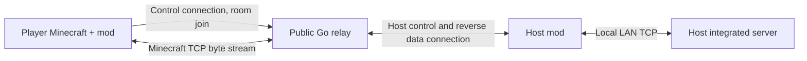

# Yiuk Switchboard

## 中文

Yiuk Switchboard 为 Minecraft Java 版单人世界的“对局域网开放”提供公网接入能力。它由一个 Go TCP 中转服务和一个 NeoForge 客户端模组组成，目标版本为 **Minecraft 1.21.1 / NeoForge 21.1 / Java 21**。

## 项目背景

Minecraft 单人世界开放到局域网后，实际运行世界的是房主客户端中的集成服务器。局域网之外的朋友通常无法直接连接：家庭网络可能位于 NAT 或运营商级 NAT 后面，路由器也未必能配置端口转发；让所有玩家安装专用服务器、迁移存档或自行配置公网网络也增加了使用成本。

本项目在有公网入口的机器上运行一个轻量中转服务。玩家通过中转服务连接到房间，房主模组再把连接接入房主客户端开放的 LAN 世界。房主仍可使用单人世界和原有存档，玩家不需要自行寻找房主的家庭公网地址。

## 提供的解决方案


中转服务负责认证、房间与端口分配、玩家连接配对和 TCP 字节转发；它不启动 Minecraft、不读取或修改 Minecraft 游戏数据，也不承载世界 tick。玩家、实体、区块和存档仍由房主的 Minecraft 集成服务器管理。

房主和玩家安装同一个客户端模组。模组提供房间创建、房间列表、加入前模组版本提示、房主连接状态、心跳和控制连接恢复。模组清单用于提示差异，不会自动下载或安装模组。

房主与中转服务在同一台电脑时，服务端可尝试直接连接本机 LAN 端口，绕过房主模组的数据转发代理；其他部署继续使用房主模组发起的反向数据连接。两种方式传输的都是原始 Minecraft TCP 字节流。

## 网络与协议

- 控制通道和配对握手使用长度前缀 Protobuf，定义见 [`proto/switchboard.proto`](proto/switchboard.proto)。
- 控制协议版本为 **2**。旧 JSONL 版服务器与新版模组不兼容；服务端 exe 和客户端 JAR 必须使用同一协议版本。
- 玩家游戏连接建立配对后，中转服务只转发字节，不解析游戏协议。
- 房间和身份状态保存在内存中；服务重启后，玩家需要重新创建房间。
- 当前控制连接未加 TLS，密码会通过普通 TCP 发送。公网部署时请设置独立的强密码，不要复用其他服务的密码。

## 服务端部署

### 1. 准备公网主机和端口

准备一台玩家和房主都能访问的公网主机。默认配置使用：

| 用途 | 默认端口 | 协议 |
| --- | --- | --- |
| 控制连接 | `25564` | TCP |
| 房间连接 | `25570–25599` | TCP |

需要在云厂商安全组和主机系统防火墙中都允许上述控制端口及**整个房间端口范围**的入站 TCP 流量。默认 30 个房间端口对应最多 30 个同时开放的房间。若修改端口配置，防火墙规则也要同步修改。

### 2. 创建服务端配置

将 [`configs/config.yaml`](configs/config.yaml) 复制到服务运行目录并命名为 `config.yaml`。分别设置服主和玩家使用的随机强密码：

```yaml
control_port: 25564
room_port_min: 25570
room_port_max: 25599
host_password: "替换为服主随机长密码"
player_password: "替换为玩家随机长密码"

max_rooms: 30
max_players_per_room: 8
max_pending_per_room: 16
pending_timeout_sec: 10
reconnect_grace_sec: 30
heartbeat_timeout_sec: 45
session_idle_timeout_sec: 300
max_connections: 1024
auth_rate_per_min: 10

log_file: "relay.log"
```

模板中的 `12345678` 是示例值，服务端会拒绝使用该值启动。`log_file` 相对服务进程的当前工作目录解析；设为空字符串可关闭文件日志。配置文件应限制为服务账户可读，避免泄露共享密码。

### 3. 构建并启动

安装 Go 工具链后，在仓库根目录构建：

```powershell
# Windows
go build -o relay.exe ./cmd/relay
.\relay.exe -config .\config.yaml
```

```sh
# Linux amd64
GOOS=linux GOARCH=amd64 go build -o relay ./cmd/relay
./relay -config ./config.yaml
```

也可以在开发环境直接运行 `go run ./cmd/relay -config ./config.yaml`。服务以前台进程运行；使用 Ctrl+C 或服务管理器的正常停止操作可以触发优雅退出。不要用强制结束代替正常停止，否则内存中尚未达到批写阈值的日志可能丢失。

### 4. 更新或重新构建服务端

源码构建得到的服务端必须与协议版本 2 客户端模组配套。Go 依赖由 Go modules 管理；如果目标机不便构建，可在对应操作系统上构建后复制可执行文件和配置。不要把含有真实密码的 `config.yaml` 上传到公共仓库。

## 安装客户端模组

1. 房主和所有玩家安装 Minecraft **1.21.1** 与兼容的 **NeoForge 21.1** 客户端。
2. 下载或构建同一版本的 `yiukswitchboard-*.jar`，放入每个客户端实例的 `mods` 目录。
3. 启动游戏；在模组提供的中转服务器入口中添加服务器地址、控制端口、房间密码和昵称。地址填写 `主机名或IP:控制端口`，例如 `relay.example.com:25564`。
4. 房主与玩家填写相同的中转地址和密码。不要将本机 LAN 端口填入中转服务器地址。

模组配置保存在游戏目录的 `config/yiukswitchboard.json`。如果在界面选择记住密码，该本地文件会保存凭据；共享电脑上应关闭记住密码。

## 开房与加入

**房主：** 启动模组并进入要联机的单人世界，在暂停菜单打开中转开房入口，填写房间名称和人数并创建。模组会开放世界的 LAN 服务、向中转服务登记房间，然后显示房间状态和公网加入地址。开房期间不要关闭世界或退出游戏。

**玩家：** 在多人游戏页面选择中转服务器并登录，刷新房间列表，选择房间查看模组版本差异，然后继续连接。若房主关闭房间或退出世界，玩家的连接也会结束。

## 默认限制与资源参考

下表是容量规划参考，不是性能保证。空闲基线来自本机 Windows 上启动 relay、无房间和玩家、关闭文件日志后的单次采样；并发负载数字是按代码分配估算，未通过 Minecraft 多客户端压力测试。

| 场景 | 内存参考 | CPU 参考 |
| --- | --- | --- |
| 空闲启动后 | 工作集约 **9.4 MiB**；Private Bytes 约 **45.6 MiB**。Private Bytes 包括当前未驻留的私有提交页，因此会大于工作集。 | 预热后 5 秒采样记录到 **0 秒 CPU 时间**；启动阶段不计入空闲值。 |
| 小规模联机（约 1–8 名活跃玩家、普通流量） | 加上会话缓冲、连接和 goroutine 后通常仍是几十 MiB 级。 | 基于转发逻辑估算，普通流量平均预计低于单个现代 CPU 核的 **5%**；区块传输会有短时峰值。这不是实测值，可从 **1 个 vCPU** 起步。 |
| 默认玩家上限（30 房间 × 每房间 8 人） | 粗估约 **30–70 MiB 工作集**，随流量、Go 版本、操作系统和 TCP 缓冲而变。 | 取决于总流量和包率；当前没有该规模的压测数据。 |

每条进入控制端口的 TCP 连接会分配约 **64 KiB** 的帧读取缓冲，因此 1024 条连接的理论缓冲上限约为 **64 MiB**，还未计入 Go 运行时、转发缓冲和操作系统 TCP socket 内存。`max_connections` 是保护上限，不代表已验证的容量。小规模部署可先预留 **128 MiB RAM**；接近配置上限前应在目标操作系统和网络环境下压测。

## 构建与开发

构建 Go 服务端：

```sh
go build ./...
go build -o relay ./cmd/relay 
```

构建客户端模组需要 64 位 Java 21 JDK。在 Windows PowerShell 中：

```powershell
cd mod
.\gradlew.bat build
```

构建产物位于 `mod/build/libs/`。首次构建需要联网下载 Gradle、Minecraft、NeoForge 和插件依赖。开发客户端可用 `.\gradlew.bat runClient` 启动。详见[模组开发环境指南](mod/docs/development-environment.md)。

## 常见问题

- **客户端无法登录：** 检查填写的地址、控制端口和密码；服务端配置不能使用模板示例密码。
- **房间列表为空或无法加入：** 确认房主已开房、客户端协议/JAR 版本匹配，并且云安全组和系统防火墙都放行房间端口范围。
- **房主能开房但玩家连接超时：** 单独开放控制端口不够，必须开放 `room_port_min` 至 `room_port_max` 的整个 TCP 范围。
- **旧客户端报协议版本错误：** 同时升级中转服务和房主/玩家使用的模组 JAR。
- **双击 Windows exe 后窗口退出：** 建议从终端运行 `relay.exe -config config.yaml`，便于看到错误信息并确认配置路径。
- **玩家看见动作卡顿：** 中转只做 TCP 转发，不运行世界 tick。可先排查房主集成服负载、游戏内模组、网络丢包和帧率；资源上限不等于已完成游戏体验验收。

## 文档

- [完整项目技术文档](docs/项目技术文档.md)：项目结构、架构、协议、生命周期和问题处理记录。
- [服务端架构规划](docs/server-architecture.md)：Go 包职责与阶段规划。
- [客户端开发规划](mod/docs/development-plan.md)：模组界面流程和开发计划。

---

## English

Yiuk Switchboard provides public access to Minecraft Java single-player worlds opened to LAN. It consists of a Go TCP relay and a NeoForge client mod, targeting **Minecraft 1.21.1 / NeoForge 21.1 / Java 21**.

## Background

When a Minecraft single-player world is opened to LAN, the host's integrated server runs the world. Friends outside the local network often cannot connect directly: the host may be behind NAT or carrier-grade NAT, router port forwarding may be unavailable, and asking everyone to configure public networking or move the save to a dedicated server adds friction.

This project runs a small relay on a publicly reachable machine. Players connect to a room on that relay, and the host mod bridges each connection to the LAN world opened by the host client. The host keeps using the single-player world and its existing save; players do not need the host's home IP address.

## What it provides



The relay handles authentication, room and port allocation, player pairing, and byte-transparent TCP forwarding. It does not start Minecraft, read or modify game packets, or run world ticks. Players, entities, chunks, and saves remain under the host's Minecraft integrated server.

The host and players install the same client mod. It provides room creation and browsing, a pre-join mod-version notice, host connection status, heartbeats, and control-connection recovery. The mod manifest is informational; mods are not downloaded or installed automatically.

When the relay and host are on the same machine, the relay can try connecting directly to the local LAN port and bypass the host mod's data-forwarding proxy. Other deployments use a reverse data connection initiated by the host mod. Both paths carry the original Minecraft TCP byte stream.

## Network and protocol

- Control messages and pairing handshakes use length-delimited Protocol Buffers, defined in [`proto/switchboard.proto`](proto/switchboard.proto).
- The control protocol is version **2**. It is incompatible with the older JSONL server and mod; use a server executable and client JAR built for the same protocol version.
- After a player connection is paired, the relay forwards bytes without parsing the Minecraft game protocol.
- Room and identity state are kept in memory. Players must create rooms again after a relay restart.
- Control connections do not use TLS, so passwords travel over plain TCP. Use unique, strong passwords for this service.

## Deploy the server

### 1. Prepare a public host and ports

Use a public machine reachable by both the host and players. The defaults are:

| Purpose | Default port | Protocol |
| --- | --- | --- |
| Control connection | `25564` | TCP |
| Room connections | `25570–25599` | TCP |

Allow inbound TCP for the control port and the **entire room port range** in both the cloud security group and the host operating-system firewall. The default 30 room ports allow up to 30 open rooms. Update firewall rules if you change the port settings.

### 2. Create the server configuration

Copy [`configs/config.yaml`](configs/config.yaml) to the server's working directory as `config.yaml`. Set separate unique random secrets for hosts and players:

```yaml
control_port: 25564
room_port_min: 25570
room_port_max: 25599
host_password: "replace-with-a-long-random-host-secret"
player_password: "replace-with-a-long-random-player-secret"

max_rooms: 30
max_players_per_room: 8
max_pending_per_room: 16
pending_timeout_sec: 10
reconnect_grace_sec: 30
heartbeat_timeout_sec: 45
session_idle_timeout_sec: 300
max_connections: 1024
auth_rate_per_min: 10

log_file: "relay.log"
```

Example passwords and identical host/player passwords are rejected by the server. The host password grants room creation and recovery; the player password grants regular login and room browsing. `log_file` is resolved relative to the process working directory; an empty string disables file logging. Restrict the config file to the service account because it contains both passwords.

### 3. Build and start

Install Go, then build from the repository root:

```powershell
# Windows
go build -o relay.exe ./cmd/relay
.\relay.exe -config .\config.yaml
```

```sh
# Linux amd64
GOOS=linux GOARCH=amd64 go build -o relay ./cmd/relay
./relay -config ./config.yaml
```

For development, run `go run ./cmd/relay -config ./config.yaml`. The relay runs in the foreground. Use Ctrl+C or the service manager's normal stop operation for graceful shutdown. Forced termination may lose logs that have not reached the batch-write threshold.

### 4. Keep server and mod versions aligned

Build or obtain a server executable compatible with the protocol version 2 client mod. Go dependencies are managed with Go modules. If building on the target host is inconvenient, build for that operating system elsewhere and copy the executable and config. Never commit a config containing the real password to a public repository.

## Install the client mod

1. Install the **Minecraft 1.21.1** and compatible **NeoForge 21.1** client on the host and every player computer.
2. Download or build the same `yiukswitchboard-*.jar` version and put it in each instance's `mods` directory.
3. Launch the game and use the relay entry provided by the mod to add the server address, control port, login password, and nickname. Enter `host-or-IP:control-port`, for example `relay.example.com:25564`.
4. Hosts enter the host password when creating a room; players enter the player password to log in and browse rooms. The login screen remains the same. Do not enter the host's local LAN port as the relay address.

Mod settings are stored at `config/yiukswitchboard.json` in the game directory. If “remember password” is enabled, credentials are stored in that local file; disable it on shared computers.

## Host and join a world

**Host:** Launch the mod and open the single-player world. Use the relay hosting entry in the pause menu, set a room name and player limit, then create the room. The mod publishes the world to LAN, registers the room with the relay, and displays its status and public join address. Keep the world open while hosting.

**Player:** Select the relay server and log in from the multiplayer screen. Refresh the room list, select a room, review the mod-version differences, and continue to connect. Closing the room or leaving the host world ends player connections.

## Limits and resource estimates

These are capacity-planning references, not guarantees. The idle baseline is one Windows sample with the relay running, no rooms or players, and file logging disabled. Concurrent-load figures are estimated from code allocations and defaults; no multi-client Minecraft stress test has validated them.

| Scenario | Memory reference | CPU reference |
| --- | --- | --- |
| Idle after startup | About **9.4 MiB working set** and **45.6 MiB Private Bytes**. Private Bytes includes committed private pages that are not currently resident, so it can exceed the working set. | A 5-second sample after warm-up recorded **0 seconds of CPU time**. Startup is excluded. |
| Small sessions (about 1–8 active players with ordinary traffic) | Usually still in the tens of MiB after adding session buffers, connections, and goroutines. | Based on the forwarding design, ordinary traffic is estimated below **5% of one modern CPU core on average**, with short chunk-transfer peaks. This is not measured; **1 vCPU** is a reasonable starting point. |
| Default player ceiling (30 rooms × 8 players each) | Roughly **30–70 MiB working set**, varying with traffic, Go version, OS, and TCP buffering. | Depends on total throughput and packet rate; no benchmark exists at this scale. |

Each TCP connection accepted on the control port allocates about **64 KiB** for frame reading. At 1,024 connections, those buffers could theoretically reach about **64 MiB**, before the Go runtime, forwarding buffers, and operating-system TCP socket memory. `max_connections` is a protection limit, not a validated capacity target. Reserve at least **128 MiB RAM** for a small deployment; benchmark the target OS and network before approaching the configured limits.

## Build and develop

Build the Go server:

```sh
go build ./...
go build -o relay ./cmd/relay
```

Building the mod requires a 64-bit Java 21 JDK. In Windows PowerShell:

```powershell
cd mod
.\gradlew.bat build
```

The JAR is written to `mod/build/libs/`. The first build downloads Gradle, Minecraft, NeoForge, and plugin dependencies. Launch the development client with `.\gradlew.bat runClient`. See the [mod development environment guide](mod/docs/development-environment.md).

## Troubleshooting

- **Cannot log in:** Check the server address, control port, and password. The server rejects the example password in the template.
- **Room list is empty or joining times out:** Make sure the host opened a room, client and server protocol/JAR versions match, and both the cloud security group and OS firewall allow the full room port range.
- **Hosting works but players time out:** Opening only the control port is insufficient; allow the full TCP range from `room_port_min` through `room_port_max`.
- **Protocol version error:** Update the relay and the JARs on both host and player clients together.
- **The Windows executable closes when double-clicked:** Run `relay.exe -config config.yaml` from a terminal to see errors and confirm the config path.
- **Players see choppy movement:** The relay only forwards TCP and does not run world ticks. Check the host integrated-server load, in-game mods, packet loss, and frame rate. Configured limits do not mean the gameplay experience has been validated at that scale.

## Documentation

- [Full project technical documentation](docs/项目技术文档.md): structure, architecture, protocol, lifecycle, and issue history.
- [Server architecture plan](docs/server-architecture.md): Go package responsibilities and development phases.
- [Client development plan](mod/docs/development-plan.md): mod UI flow and development plan.
