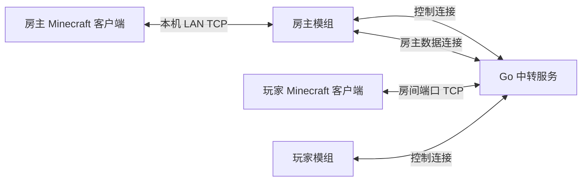
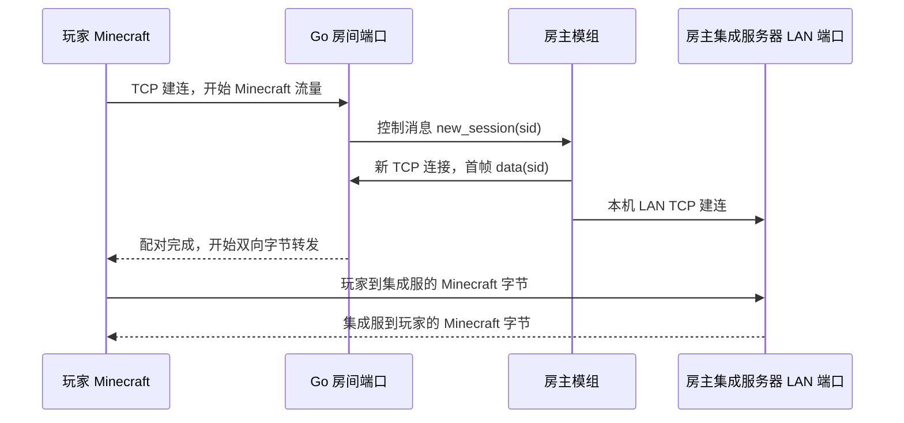

# Yiuk Switchboard 项目技术文档

> 本文按仓库当前代码整理，覆盖 Go 中转服务、Minecraft 客户端模组、连接模型、协议、生命周期、开发构建、故障处理和已知限制。代码路径以仓库根目录为基准。

## 1. 项目解决什么问题

房主在自己的 Minecraft Java 客户端里打开单人世界的“对局域网开放”。其他玩家通过公网 Go 服务的房间端口加入。Go 服务只负责身份控制、房间分配和 TCP 字节转发，不运行 Minecraft 世界，也不解码 Minecraft 游戏协议。真正的玩家、实体、区块、存档和 tick 仍由房主客户端内的 Minecraft 集成服务器负责。

当前目标版本是 Minecraft 1.21.1、NeoForge、Java 21。模组同时承担房主端和玩家端功能；玩家与房主安装同一个客户端模组。

**系统边界：**

- Go 中转负责认证、房间元数据、端口监听、会话配对、连接限额和原始 TCP 转发。
- Java 模组负责原版界面入口、登录和房间浏览、模组清单比较，以及房主到本地 LAN 服务的接续。
- Minecraft 集成服务器负责游戏状态和权威模拟。Go 服务不控制服务器 tick，也不改写玩家移动包。
- 模组清单只用于加入前提示版本差异，不会自动下载或安装模组。

## 2. 仓库结构

```text
.
├─ cmd/relay/                 Go 程序入口和启动参数
├─ internal/
│  ├─ auth/                   按来源 IP 限制认证频率
│  ├─ config/                 YAML 默认值、读取和合法性检查
│  ├─ connlimit/              进程级连接预算
│  ├─ control/                控制连接认证与 Protobuf 请求分派
│  ├─ protocol/               Go 协议结构、Protobuf 编码和长度帧读取
│  ├─ room/                   房间、端口、玩家接入、sid 配对和清理
│  ├─ server/                 监听器装配、连接生命周期、优雅关闭和日志批写
│  └─ session/                两条 TCP 流的双向拷贝
├─ proto/                     Go 与 Java 共用的 Protobuf schema
├─ configs/                   可参考的 YAML 配置模板
├─ deploy/                    部署相关文件
├─ docs/                      架构、开发规划和问题复盘
├─ mod/
│  ├─ src/main/java/          NeoForge 客户端模组源码
│  ├─ src/main/resources/     模组元数据和中英文界面文本
│  ├─ src/test/java/          Java 界面布局测试
│  ├─ gradlew.bat             Gradle Wrapper
│  └─ build/libs/             构建生成的模组 JAR
├─ 我的世界联机中转系统 设计文档.md  最初的产品/协议设计
├─ go.mod                     Go 模块依赖
└─ README.md                  快速开始
```

### 2.1 Go 包边界

| 包 | 主要职责 | 关键实现 |
| --- | --- | --- |
| `cmd/relay` | 解析 `-config`，启动服务，报告启动错误 | `main.go` |
| `internal/config` | 提供端口、人数、超时、密码和日志路径默认值并校验 | `config.go` |
| `internal/auth` | 对登录尝试按客户端 IP 做时间窗口限流 | `limiter.go` |
| `internal/connlimit` | 给控制连接和游戏数据连接共享全局连接上限 | `budget.go` |
| `internal/protocol` | Protobuf 消息结构、长度帧读取、64 KiB 消息限制 | `protocol.go` |
| `internal/control` | 处理 `auth/list/create/room_mods/close/resume/ping/data` | `handler.go` |
| `internal/room` | 房间端口、成员计数、等待配对、房主重连和本机直连 | `manager.go` |
| `internal/session` | 双向 `io.Copy`；任一端结束时关闭另一端 | `pipe.go` |
| `internal/server` | 组装包依赖、接入连接、等待关机任务和批写文件日志 | `server.go`, `log_writer.go` |

依赖关系从程序入口向下：`cmd/relay → internal/server → control/room/config/connlimit`。协议和数据面位于较底层，不依赖 GUI 或 Minecraft 类型。

### 2.2 Java 模组包边界

| 包或类 | 作用 |
| --- | --- |
| `SwitchboardMod` | 模组入口；客户端特有注册由客户端代码承担 |
| `client/ClientEvents` | 在原版多人游戏页和暂停页追加入口 |
| `client/gui/` | 登录、房间列表、房主开房、房间状态和提示页面 |
| `client/host/HostRoom` | 房主控制连接、心跳/恢复、处理新玩家，并将数据流接到 LAN 端口 |
| `client/host/HostRoomState` | 保存当前活动的房主房间引用 |
| `client/RelayClient` | 供界面使用的后台 I/O 执行器，避免网络操作占用渲染线程 |
| `control/` | Java 控制连接、Protobuf 帧编解码和协议错误处理 |
| `protocol/RelayEndpoint` | 解析中转服务地址和端口 |
| `config/` | 保存中转地址、昵称和用户选择记住的凭据 |
| `mods/ModListSnapshot` | 收集本地模组 ID/版本并编码成房间清单 |
| `resources/assets/.../lang` | 中文和英文文本资源 |

模组是客户端模组；Minecraft 游戏服务器本身仍是原版集成服务器。Java 的 `HostRoom` 会临时调用 `IntegratedServer.publishServer` 开放 LAN 端口，并在房间关闭时恢复相关认证设置。

## 3. 整体架构与连接

### 3.1 部署拓扑

常见公网拓扑中，Go 中转运行在有公网入口的机器上，房主和玩家分别运行 Minecraft 客户端及模组：



房主模组另有一条常驻控制 TCP 连接。每位玩家进入房间时，Go 服务通知房主模组；房主模组为该玩家建立数据连接和本地 LAN 连接。控制连接承载长度前缀 Protobuf 帧，游戏数据连接在配对后变成透明 TCP 流。

### 3.2 普通玩家会话的数据路线



从游戏服务器到玩家的方向是同一对 socket 的反向字节流。正常路径中，字节经过 Go 的 TCP 读写和 Java 房主代理的 TCP 读写后才到集成服务器/玩家。

### 3.3 本机中转直连路径

当 Go 中转和房主运行在同一台机器时，Go 可以从房间玩家连接直接连接 `127.0.0.1:<local_port>`。房主模组在 `create` 消息中发送 LAN 端口；Go 还检查房主控制连接 IP 是本机地址，并检查玩家连接来源是否是回环地址或相同本机地址。符合条件且 LAN 端口可连接时，Go 直接转发该玩家的 Minecraft TCP 流，省去每位玩家对应的 Java 房主 socket 代理。

如果客户端较旧、没有上报 `local_port`，或者来源/端口检查不满足，Go 继续走普通 `new_session → data(sid) → Java 本地连接` 流程。直连仅是数据路径优化；Minecraft tick、实体同步和世界逻辑仍由原版集成服务器执行。

## 4. 控制协议和会话状态

### 4.1 控制消息

控制通道采用 `proto/switchboard.proto` 定义的 Protocol Buffers。每帧先写标准 varint 编码的消息长度，再写 protobuf 消息体；单个消息体最多 64 KiB。`type` 枚举表示消息类型。Go 与 Java 客户端使用对应 schema 的 wire 编解码，字段编号和枚举编号必须保持一致。认证中的协议版本为 2；该版本不兼容旧 JSONL 服务端和旧模组，服务端与客户端必须一起更新。
当前仓库没有引入生成器或 Protobuf 运行库：Go 的 `internal/protocol/protocol.go` 和 Java 的 `control/ProtobufWire.java` 按共享 schema 手动实现 protobuf wire 格式。这避免在构建中下载/携带运行库，但修改 `.proto` 时必须同步更新两端编码器和解码器。Java 控制层使用 `RelayMessage` 作为类型化进程内数据，Protobuf wire 编解码不经过 JSON；配置文件仍是本地 JSON，与网络协议无关。

| 字段号 | Protobuf 字段 | 用途 | Wire 类型 |
| --- | --- | --- | --- |
| 1 | `type` | 消息类型枚举（1–15） | varint |
| 2–7 | `password/name/protocol_version/max_players/minecraft_version/loader` | 认证、昵称与建房信息 | length-delimited 或 varint |
| 8 | `mods` | 重复 `Mod{id, version}` | length-delimited |
| 9–15 | `room_id/session_id/token/port/local_port/error_code/message` | 房间标识、配对、结果和错误 | length-delimited 或 varint |
| 16 | `rooms` | 重复 `RoomSummary` | length-delimited |

嵌套 `Mod` 字段号为 `id=1/version=2`；`RoomSummary` 字段号为 `id=1/name=2/host=3/port=4/players=5/max_players=6/minecraft_version=7/loader=8/mod_count=9`。帧长前缀是 varint，不是固定 4 字节整数。

| 消息 | 方向 | 主要字段 / 用途 |
| --- | --- | --- |
| `auth` | 客户端 → Go | `pw/name/ver`：校验共享密码和协议版本 |
| `ok` / `err` | Go → 客户端 | 认证或操作结果；错误附带 `code/msg` |
| `list` / `rooms` | 双向 | 房间摘要、人数、版本、端口等 |
| `create` / `created` | 双向 | 建房元数据、人数、模组清单；房主还发送 `local_port` |
| `room_mods` / `mods` | 双向 | 加入前取房间完整模组清单 |
| `close` | 客户端 → Go | 房主申请关闭房间 |
| `ping` / `pong` | 双向 | 房主控制连接保活 |
| `resume` | 客户端 → Go | 以房间 ID 和随机 token 恢复控制连接 |
| `new_session` | Go → 房主 | 通知房主为某个玩家开启数据连接 |
| `data` | 房主 → Go | 数据连接首帧，携带一次性 `sid`；之后不再解析控制协议 |

目前共享密码通过普通 TCP 控制连接传输，未做 TLS。应只用于可信网络或自行在传输层提供保护；不要把真实部署密码提交到代码仓库。

### 4.2 建房和玩家配对

1. 房主进入单人世界，在暂停菜单创建中转房间。
2. 模组读取/申请 LAN 端口，向 Go 发送 `create`，其中包括游戏版本、加载器、房间人数、模组清单以及本机直连所需端口。
3. Go 校验字段，为房间绑定一个 `room_port_min..room_port_max` 范围内 TCP 端口，产生随机房间 ID 和恢复 token。
4. Go 返回 `created` 后，模组在 Minecraft 主线程打开 LAN 监听器，再启动控制连接 reader 和心跳。
5. 玩家通过原版服务器连接流程访问 `Go 地址:房间端口`。
6. Go 生成一次性随机 `sid`，记录等待通道，并向房主控制连接发送 `new_session`。
7. 房主 Java 端收到通知后打开 socket，发送 `data(sid)`；Go 删除并消费该 `sid`，将玩家 socket 与房主 socket 配对。
8. `session.Pipe` 启动两个独立 goroutine，分别执行两个方向的读写复制。任一方向关闭时同时关闭两端，释放连接和玩家数。

房间处于等待配对状态有超时；人数上限和每房间 pending 上限在 Go 端执行。进程级连接预算由控制 socket、玩家 socket、房主数据 socket等共享，防止连接数无界增长。

### 4.3 缓冲边界为何重要

Go 处理房主 `data` 首帧时使用 `bufio.Reader`。一次底层 TCP 读取可能同时拿到 Protobuf 帧和后续 Minecraft 游戏字节；如果切换为原始 `net.Conn` 读取，就可能丢掉 reader 已经预读的数据。因此 `Pair` 把原 reader 一同交给会话复制层，由 `readerConn.Read` 先消费已缓存内容。

## 5. 并发、房间生命周期和资源清理

### 5.1 并发模型

- Go 每条控制连接由独立 goroutine 处理；每个房间 listener 接收连接后，为玩家会话启动独立处理 goroutine。
- Go `session.Pipe` 的两个方向并行，不通过控制协议编码游戏字节，也不在每次读写时写日志。
- 房主 Java 端用 Java 21 虚拟线程执行控制读取、玩家 socket 转发和连接复制任务；同时用信号量限制并发转发会话。
- 控制连接的异步 Protobuf 帧写入通过 Java/Go 侧的锁串行化；该锁不覆盖游戏数据 socket。
- 房间状态由 `room.Manager` 管理；单房间状态有互斥锁保护。关闭房间时关 listener、清 pending、关闭活动连接。

### 5.2 控制断线恢复

房主每 5 秒发心跳；客户端在 pong 超时后尝试重新认证，使用房间 ID 与内存中的随机 token 发送 `resume`。Go 在配置的恢复宽限时间内保留房间 listener，接受有效 token 替换房主控制连接。旧连接稍后触发的断线回调用 owner key 做代际检查，避免误关已经恢复的房间。

恢复的是房间控制权和新玩家接入能力，不保证物理网络中断时已有 Minecraft TCP 会话不掉线。玩家断开后仍需重新加入。

### 5.3 服务进程优雅退出

Go 进程通过 `signal.NotifyContext` 接收 Ctrl+C/`os.Interrupt` 和平台支持的 `SIGTERM`。接到退出信号后，退出顺序如下：

1. `Server.shutdown` 用 `sync.Once` 保证只执行一次；并发触发的退出路径会等待同一个 `shutdownDone`，不会有一条路径提前返回。
2. 标记 server 关闭，关闭控制 listener，并关闭已登记的控制连接，拒绝后续连接。
3. `room.Manager.CloseAll` 原子标记 manager closing 并关闭 done channel；新建房间随即拒绝，pending 玩家从等待配对中唤醒。
4. 删除所有房间、关闭房间 listener 和活动 socket。socket close 会解除阻塞的 TCP 读写；连接配对、玩家处理和房间接入 goroutine 都由 manager wait group 追踪并等待。未到期的房主恢复 timer 会取消并计入/释放同一等待组，已开始的 timer callback 会运行完成。
5. `Server.Run` 等待控制连接处理循环退出，然后才返回到 `RunFromConfig`。
6. 记录“服务停止、正在刷新日志”，把内存中剩余日志写入文件，调用 `Sync`，关闭文件句柄。刷新、同步或关闭失败会合并进最终返回错误。

因此，正常 Ctrl+C/`SIGTERM` 路径会在日志 flush 完成后结束。任务管理器强制结束、`TerminateProcess`、断电或系统崩溃不会运行 Go defer，无法保证执行关机流程或保存内存中未达到阈值的日志。

**本机退出验证：** 启动新版 relay 后，运行期间 `shutdown-verification.log` 为 0 字节；发送 Ctrl+C 后进程结束，日志文件出现启动记录和“relay process stopped; flushing logs”最终记录，总计 261 字节，且没有残留 relay 进程。这验证了低于 64 KiB 的记录确实在正常退出时写出。此验证只覆盖本机空房间退出，不是高并发下的长时间压力测试。

### 5.4 超时和连接上限

Go 配置包含控制端口、房间端口范围、房间上限、玩家上限、pending 上限、等待配对超时、房主恢复宽限、心跳超时、游戏流空闲超时、全局连接上限和认证限速。当前默认值见 `internal/config/config.go`；YAML 可以覆盖默认值。空闲游戏流默认 300 秒后清理。房间表目前保存在内存中，进程重启后房间状态消失。

## 6. 配置、安全与运行

### 6.1 配置

`configs/config.yaml` 是仓库内的配置模板，模板中的 password 不能直接用于运行。复制成运行目录的 `config.yaml`，设置非示例密码；房主/玩家模组必须使用同一中转地址和密码。不要把真实密码写入共享仓库。`log_file` 相对服务进程的当前工作目录解析。

启动程序支持 `-config <路径>`。未传时尝试当前工作目录、exe 所在目录和 exe 上一级目录的 `config.yaml`。缺少文件或配置不合法时会输出错误；Windows 控制台启动遇到错误会等待 Enter，避免双击时窗口瞬间消失。

默认文件日志使用 JSON Lines 格式。logger 先将记录写入进程内存，累计达到 **64 KiB** 时作为一批写入配置的 `log_file`；退出顺序会在服务和会话 goroutine 停止后 flush 剩余内容、Sync 并关闭文件。未达到阈值的记录只在内存中，进程被强制结束时可能丢失；希望减少这段风险时可调低源码中的 `internal/server/server.go` 阈值，代价是更频繁写文件。日志批写不加入固定周期 timer，因此不会每隔几秒触发一次磁盘写入。

TCP 防火墙需放行控制端口以及整个房间端口范围。客户端连上控制端口只表示控制服务可达，不代表密码正确、房间可配对或 Minecraft 游戏流可达。

### 6.2 安全边界

- 密码比较使用常量时间比较；认证按来源 IP 限速。
- 房间 ID、会话 `sid` 和恢复 token 使用 `crypto/rand` 生成。
- 控制 Protobuf 消息有限长；房间数、玩家数、等待数和全局连接数有限制。
- 房间关闭和进程退出会关闭监听器与活动连接。
- 密码目前明文经过 TCP；尚未实现 TLS、账号体系或持久化数据库。
- 房间列表和日志不应显示密码、token 或游戏流内容。
- 模组记住密码时本地配置是明文，界面会提示这一点；不要在多人共用的系统账号中启用记住密码。

### 6.3 构建

Go 服务端（Go 1.26 或兼容仓库 `go.mod` 的工具链）：

```powershell
go test -race ./...
go build -o bin/relay.exe ./cmd/relay
```

Minecraft 模组（64 位 JDK 21）：

```powershell
cd mod
.\gradlew.bat test jar
```

构建产物位于 `mod/build/libs/yiukswitchboard-0.1.0.jar`。开发客户端入口是 `.\gradlew.bat runClient`。玩家和房主都应安装目标 Minecraft/NeoForge 版本兼容的同一模组版本。

## 7. 项目遇到的问题与处理记录

本节区分“已定位并修复”“针对风险做了改动”和“仍未确认”。测试通过不等于 Minecraft 实际联机体验已经验收。

### 7.1 控制行读取可能吞掉游戏流起始字节

**问题：** `data` 握手与后续游戏字节处在同一 TCP 连接。带缓冲 reader 读取一行时可能提前读取到后续 Minecraft 数据。如果完成握手后改用 socket 原始 reader，已被缓冲的字节会被忽略，连接会损坏。

**处理：** 配对时把同一个 buffered reader 包装进 `readerConn`，会话复制从它继续读取。对玩家可见的是原样 Minecraft TCP 流。

**验证/状态：** 当前代码包含该处理。后续协议改动仍必须保留这个约束。

### 7.2 游戏连接误用控制通道的 10 秒初始读取 deadline

**问题：** 服务端在收到首帧 `data` 后将 socket 转交给游戏会话。如果保留首次握手阶段的短 read deadline，持续游戏连接会在握手时间后被关闭。

**处理：** 成功配对后清除 read deadline，再由游戏流空闲超时单独管理生命周期。

**状态：** 已在 `control.Handler.ServeConn` 中明确清零 deadline。

### 7.3 房主控制连接掉线后房间和 listener 的状态不一致

**问题：** 旧控制连接可能处于半开状态；恢复连接与旧连接的退出回调、宽限 timer 有竞态，旧回调可能覆盖新房主或关闭已恢复房间。

**处理：** 加入随机房间 token、owner key 代际校验、有限时间宽限、可接管的 `resume` 以及互斥保护。客户端用有限重试窗口重新认证，并把 UI 状态更新切回 Minecraft 主线程。

**状态：** 代码路径已实现；复杂断网、半开 socket 与进程级故障注入仍需额外运行测试。

### 7.4 重复关闭和关闭后残留转发 socket

**问题：** 房间关闭、世界退出和应用退出可能并发发生；未登记/未关闭的数据 socket 会使虚拟线程仍阻塞在读写中。

**处理：** Java 侧使用关闭状态门、并发 socket 集合和幂等清理；关闭时关闭活动 forwarding sockets。Go 侧追踪活动会话连接，房间关闭时关闭它们。UI 主动关房等待有限时间的 `ok/err` 确认；退出路径仍能尽力本地关闭。

**状态：** 清理代码已存在；真实 Minecraft 进程强制结束、网络拔线等情况没有完整故障注入报告。

### 7.5 登录尝试、房间和连接数需要限制

**问题：** 公网服务如果没有限额，错误登录、pending 玩家或长时间空闲连接可能占用 goroutine、端口和文件句柄。

**处理：** 加入来源 IP 认证限速、每进程共享 connection budget、房间/玩家/pending 限额、会话空闲清理和单次配对超时。随机 `sid` 只消费一次。

**状态：** 机制已进入代码；真实规模压测及长期运行内存曲线尚未完成。

### 7.6 双向 TCP 转发卡顿的排查与结构调整

**现象：** 本机两端通过中转联机时，移动自己看起来流畅，远端玩家的动作呈间歇跳动；后续反馈进一步明确为“玩家动作在房主视角流畅，房主动作在玩家视角卡”。这是方向性现象：玩家输入到服务器的路径可以工作，房主集成服发往玩家的同步方向更值得检查。玩家本地移动平滑可能来自客户端预测，不足以证明服务器同步正常。

**代码审查结果：**

1. Java 房主代理用两个独立任务进行 TCP 双向流复制；Go 用两个 goroutine 进行 `io.Copy`。没有逐游戏包 JSON 转换、按时间攒包或每包日志。
2. 房主 Java 数据 socket 显式设置 `TCP_NODELAY`；本机缓存的 Minecraft 1.21.1/NeoForge 源码也显示原版客户端和服务端连接启用了 TCP_NODELAY。因此“Nagle 一定在积攒移动包”没有代码证据支持。
3. 普通中转模型有额外代理跳数：Minecraft 远端 ↔ Go relay ↔ Java 房主代理 ↔ 房主集成服 LAN socket。透明字节转发仍可能受到 CPU 调度、TCP 背压或 OS 网络抖动影响，但静态代码不能证明它是卡顿根因。
4. 曾加入过每 5 秒采样集成服 tick 并写 warning 的尝试。该方案会增加日志 I/O，不能作为性能修复；已从代码移除，不应重新加入逐包或周期性高频日志。

**合成测试结果：** 曾在本机用 Go relay 和 TCP 回显服务比较直连、relay 和模拟房主代理桥。10,000 次小请求回显的 relay 桥接 p99 约 0.71–1.00 ms，最大值约 10.55–10.74 ms；20 Hz 小包测试中，直连最大间隔约 50.92 ms，桥接最大约 51.32 ms，均没有观察到超过 75 ms 的间隔。测试说明合成 TCP 流中没有复现肉眼可见的长时间卡顿，但**不是 Minecraft/NeoForge 实机测试**，不能据此排除集成服 tick、mod、GPU/帧调度或游戏包处理问题。

**本机快速路径处理：** 当 Go relay 和房主在同一台机器时，普通模型的 Java 反向代理可被省去。模组上报 `local_port`，Go 检查房主控制连接与玩家来源的本机 IP，并直接连接本机 Minecraft LAN 端口；连接失败或非本机部署时回退原路径。增加了 `TestLocalHostFastPath`，使用真实本机 TCP socket 检查游戏流双向转发以及不请求 Java `new_session`，Go race 测试通过。

**当前结论：** 这项改动优化了中转在房主同机部署时的数据路径，不能宣称已经解决用户的方向性卡顿。当前没有把 Minecraft tick 或实体更新逻辑移出集成服务器，也没有用实际两个 Minecraft 客户端证明游戏内卡顿消失。远端部署（Go 在 VPS、房主在家）仍走原反向隧道代理架构。

### 7.7 进程退出时未等待全部会话和文件日志

**原状：** 旧的退出逻辑会处理系统信号、关闭 server listener 和登记的控制 socket，但 room listener 创建的玩家处理 goroutine及会话复制没有被 server 统一等待。日志 handler 直接持有文件 writer，没有显式 flush、`Sync` 和 close。于是虽然主要 listener 会停止，仍不能确认所有连接清理日志写完后再退出。

**处理：** server 增加只执行一次并可被并发退出者等待的 shutdown barrier；room manager 关闭后拒绝建房、用 done channel 解除 pending wait，并追踪/等待房间 accept、玩家 session 和恢复 timer callback。`RunFromConfig` 使用 64 KiB 内存批写 logger，并在 `Server.Run` 返回后写出最后记录、flush、`Sync`、close 文件，错误会沿返回值报告。

**状态与代价：** 正常信号退出会等待清理链结束。内存批写会使最近不足 64 KiB 的日志在进程崩溃或被强杀时丢失；这是降低常规磁盘写频率的显式取舍。请用 Ctrl+C/服务管理器 stop 请求退出，不要用强制结束代替。

### 7.8 Windows 双击 exe 后窗口一闪而过

**原因：** Go 程序默认找工作目录中的 `config.yaml`。通过 Explorer 双击 `bin/relay.exe` 时工作目录可能是 `bin`，而配置放在项目根目录或根本尚未复制；程序读配置失败后立即退出，错误窗口随之关闭。

**处理：** 启动器未指定 `-config` 时依次尝试当前目录、exe 所在目录、exe 上一级目录；找不到配置时打印需要的文件位置和配置模板提示。Windows 交互控制台遇到启动错误会等 Enter，使错误可读。显式传入 `-config` 时则严格使用给定路径。

**注意：** 这不会自动生成有效密码。仍需从 `configs/config.yaml` 复制模板并把 password 改成与模组相同的值。

### 7.9 模组 JAR 版本难以确认

**原因与处理：** 前一次交付产物的时间戳较早，无法让使用者直观确认它和当前源码是否一致。虽然字节码检查确认该文件已经包含 `HostRoom` 发送 `local_port` 的代码，为排除 Gradle 输出/缓存疑虑，仍再次执行 `clean jar` 并禁用 Gradle build cache，之后复查 JAR 字节码。构建产物路径是 `mod/build/libs/yiukswitchboard-0.1.0.jar`。

**维护要求：** 每次发布以文件路径、构建时间和 SHA-256 校验值标识；玩家和房主两端使用同一 JAR。Go 端本机直连逻辑在 relay exe 中，所以该功能必须同时部署新 Go exe 和新模组 JAR，单独替换其中一个不构成完整部署。

### 7.10 控制层从 JSONL 迁移到 Protobuf

**原状与风险：** 控制连接以前以换行分割 JSON。客户端和服务端各自依赖字符串字段名，消息边界也与换行绑定；`data` 首行还必须和后续游戏 TCP 字节共用同一个 buffered reader。

**处理：** 新增共享 schema `proto/switchboard.proto`，定义统一 Message、类型枚举、模组条目和房间摘要。Go 和 Java 都改为标准 Protobuf wire 编码，并用 varint 消息长度做 TCP 分帧；Java 网络层采用类型化 `RelayMessage`，不再经过 JSON 字符串或 Gson JSON 树。认证协议版本提升为 2。`data` 配对握手也改为 Protobuf 首帧，握手完成后仍转发原始 Minecraft TCP 数据，不解析或重编码游戏协议。玩家和房主配置文件仍保留 JSON，因为那是本地持久化，不是网络消息。

**兼容与构建：** 旧 JSONL 服务端和旧模组不能互通，服务端与客户端 JAR 必须同时更新。两端目前手动实现 wire 编解码以避免增加构建依赖；后续变更字段号或枚举号时必须同步更新 schema 与两端实现。Go `go build ./...` 和 Java `compileJava` 已通过；本次没有运行 Minecraft 双客户端联机验收。

## 8. 当前已知限制和未验收项

- 目前是 Minecraft 1.21.1 Java/NeoForge 定向实现；没有 Bedrock/UDP，也未设计多游戏版本兼容。
- Go 房间表在内存，重启后房间消失；没有数据库或管理后台。
- 控制密码没有 TLS 加密；公网部署需有可信传输保护。
- 房间模组清单只提示差异，不自动同步。
- 集成服 tick、玩家 movement 更新和实体插值仍由 Minecraft 自身负责；项目尚没有对这些游戏内部阶段做采样剖析。
- 本机 TCP 集成测试验证的是 Go 数据路径，不等同两个 Minecraft 客户端的实机 A/B。真实体验问题仍应依据方向、同一移动方、同一观察方及实际游戏帧/tick 数据判断。
- Java UI 有布局测试，但不同分辨率、PCL 实例、目标 mod 组合及完整多人生命周期仍需在实际客户端验收。
- 旧的 [Go 架构规划](server-architecture.md)、[客户端开发规划](../mod/docs/development-plan.md) 和 [诊断待办清单](联机诊断与待办清单.md) 保留了它们撰写时的阶段状态；状态或数字与本文不一致时，应以当前代码和本文件的“当前状态”说明为准。

## 9. 相关文档

- [根 README](../README.md)：编译和启动摘要。
- [初始系统设计](../我的世界联机中转系统%20设计文档.md)：产品目标和早期协议草案。
- [Go 服务端架构规划](server-architecture.md)：Go 包边界和初版里程碑。
- [客户端开发规划](../mod/docs/development-plan.md)：GUI、客户端流程和开发里程碑。
- [客户端开发环境](../mod/docs/development-environment.md)：JDK、Gradle 与 NeoForge 环境。
